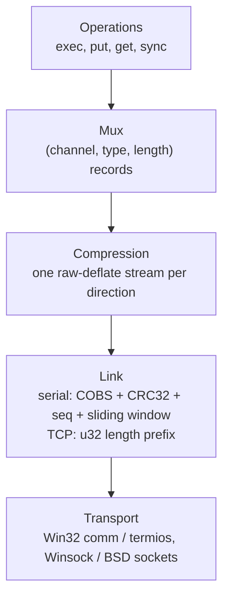

# w98link protocol, version 1

Status: agreed in iteration 1. Implemented so far: everything except the TCP
transport (iterations 2-8).

This document is the contract between the Linux client and the Win32 agent.
Both ends are built from the same `src/core` sources, but the agent on a
target can be older than the client, so the wire format is specified here
rather than left to whatever the code happens to do.

## Goals and non-goals

Goals, in priority order:

1. Never corrupt data. A file that arrives has the bytes that were sent, or the
   operation fails loudly.
2. Use a 115200 bps serial line close to its limit, and compress well, since
   compression is the only way past that limit.
3. Keep interactive output responsive while bulk data is moving.
4. Run the same operations over TCP once the target has a network card, with
   no change above the link layer.

Non-goals for v1: security (see "Authentication and encryption"), more than
one client per agent, and resuming an interrupted transfer.

## Conventions

- All multi-byte integers are **little-endian**. Both ends are x86, and a
  big-endian port is not planned; the choice is written down so it is never
  guessed.
- `u8`, `u16`, `u32`, `u64` are unsigned integers of that width. `str` is a
  `u16` byte length followed by that many bytes, not NUL-terminated.
- Sizes in this document are defaults. Values that the handshake negotiates
  are marked as such.

## Layers

Each direction of the connection is an independent stack:



The link layer delivers an ordered, lossless byte stream in each direction.
Everything above it is written as if talking to a reliable pipe, which is what
makes the compression stream possible: deflate cannot survive a lost byte.

## Link layer: serial

Serial lines lose and corrupt bytes, so this layer adds framing, integrity and
retransmission. It is used only on serial; TCP already provides all three.

### Frame encoding

On the wire, each frame is:

```
COBS(body) 0x00
```

COBS (Consistent Overhead Byte Stuffing) removes every zero byte from `body`,
at a cost of at most one byte per 254, so `0x00` is reserved as the frame
delimiter. After line noise the receiver discards bytes up to the next `0x00`
and is resynchronised; no escape state can get stuck.

`body` is:

| Field | Type | Meaning |
|-------|------|---------|
| type | u8 | frame type, below |
| seq | u16 | sequence number of this frame (DATA only; 0 otherwise) |
| ack | u16 | cumulative ack: every frame before this seq has arrived |
| sack | u32 | selective ack: bit i set means `ack + 1 + i` has arrived |
| payload | bytes | 0 to `max_payload` bytes (DATA only) |
| crc | u32 | CRC-32 (IEEE 802.3, as zlib's `crc32()`) of all preceding fields |

The header is 9 bytes, the CRC 4. With a 1024-byte payload, framing overhead
is about 1.7% including COBS and the delimiter.

A frame whose CRC does not match, whose decoded length is shorter than 13
bytes, or whose payload exceeds `max_payload` is dropped silently; the sender's
timer recovers it.

### Frame types

| Value | Name | Purpose |
|-------|------|---------|
| 1 | SYNC | start or restart a session (payload: `u32 session_id`, `u16 max_payload`, `u8 window`) |
| 2 | SYNC_ACK | answer to SYNC (payload: `u32 echoed_id` of the SYNC being answered, then this side's own SYNC payload) |
| 3 | DATA | carries the next chunk of the compressed stream |
| 4 | ACK | acknowledgement only, no payload |

Every frame carries `ack` and `sack`, so a DATA frame going one way also
acknowledges data coming the other way. A separate ACK is sent only when there
is no DATA to carry it.

### Session start

The session id lets either side tell a restart from a retransmission. On
startup, and whenever it has lost state, a side picks a random `session_id` and
sends SYNC every 500 ms until it receives a SYNC_ACK echoing that id. Both
sides then set their sequence numbers to 0 and start fresh compression streams.

If a side receives a SYNC with a session id it has not seen, the peer has
restarted. It discards all link and channel state, answers with SYNC_ACK, and
reports every open operation as failed to its user. This is what makes it safe
to kill and restart either program at any time.

`max_payload` and `window` are negotiated as the minimum of the two sides'
offers. The defaults are 1024 bytes and 16 frames.

### Reliability

Selective repeat with a sliding window:

- A sender may have at most `window` unacknowledged DATA frames in flight.
  With the defaults that is 16 KiB, about 1.4 s at 115200 bps.
- The receiver buffers out-of-order frames within the window and delivers bytes
  upward strictly in sequence order.
- Acks: the receiver sends one after every second DATA frame, or 20 ms after
  the first unacknowledged one, whichever comes first.
- Retransmission: each unacknowledged frame has a timer. The timeout starts at
  500 ms and then follows the measured round-trip time (Jacobson/Karels, with
  Karn's rule of not timing retransmitted frames), clamped to 200 ms - 5 s. A
  frame missing from `sack` while later frames are present is resent
  immediately, without waiting for its timer.
- Sequence numbers are `u16` and wrap. Comparisons use serial-number
  arithmetic (RFC 1982); with a window of at most 255 frames this is never
  ambiguous.

### Liveness

When there is nothing else to send, each side sends an ACK every 2 s. If
nothing valid arrives for 10 s, the link is declared down: open operations fail
and the side returns to sending SYNC.

## Link layer: TCP

TCP delivers an ordered, lossless stream, so the link layer only preserves
frame boundaries:

```
u32 length, then `length` bytes of payload
```

No CRC, sequence numbers or retransmission. A session is one TCP connection;
the SYNC exchange is replaced by the connection itself, and a dropped
connection has the same effect as a peer restart on serial. `max_payload` for
TCP is 64 KiB. The agent listens on TCP port 2098 by default.

## Compression layer

Each direction is one raw deflate stream (zlib with `windowBits = -15`, no zlib
or gzip header), created when the session starts and kept for its whole life.
Because the stream is shared by all channels, anything sent earlier (file
contents, command output, sync manifests) becomes dictionary for everything
sent later. That is where most of the gain on repetitive development traffic
comes from.

- The sender compresses mux records as they are queued. When its record queue
  empties, it issues `Z_SYNC_FLUSH`, so the receiver can decode everything sent
  so far. A flush costs 4-5 bytes, so flushing only when idle keeps bulk
  transfers efficient and interactive output prompt.
- The compressed bytes are cut into link frames of up to `max_payload`. Frame
  boundaries have no relation to record boundaries.
- Default level 9 on serial, where CPU is free next to an 11 KB/s line; TCP
  will want a lower one. The level is a local choice and needs no
  negotiation; deflate output is decodable at any level.
- Data that is already compressed (zip, jpeg and the like) costs CPU for no
  gain. v1 accepts that: a Pentium III compresses far faster than the serial
  line can carry the result. Per-channel level switching is a later
  optimisation.

Memory per side is about 256 KiB for deflate at the default settings and 44
KiB for inflate, which is comfortable on the A21m.

## Mux layer

The decompressed stream is a sequence of records:

| Field | Type | Meaning |
|-------|------|---------|
| channel | u16 | 0 is the control channel; operations use 1-65535 |
| type | u8 | record type, meaning depends on the channel's kind |
| length | u16 | payload length, 0 to 16384 |
| payload | bytes | |

### Fairness

A bulk transfer must not starve an interactive channel. The sender cuts bulk
payloads into records of at most 4 KiB and serves channels with queued data in
round-robin order. Combined with a 1 KiB frame, a line of `exec` output queued
behind a file transfer waits for at most one window of already-compressed data
(about 1.4 s on serial, negligible on TCP).

### Flow control

Each channel has a credit window, in the style of SSH: a receiver grants the
sender a number of bytes (initially 64 KiB) and tops it up with WINDOW records
as its consumer drains data. A sender never exceeds its credit. This keeps a
slow consumer, such as a full pipe on the agent or a slow disk, from stalling
every other channel.

### Channel lifecycle

The side that starts an operation picks a free channel number and sends OPEN
on the control channel. The other side answers OPEN_OK or OPEN_FAIL. Either
side may send CLOSE; a channel number can be reused once both sides have sent
CLOSE for it. By convention the client uses odd channel numbers and the agent
even ones, so the two sides never race for the same number.

## Control channel (channel 0)

| Type | Name | Payload |
|------|------|---------|
| 1 | HELLO | `u16 proto_version`, `str build_version`, `u8 platform`, `u32 capabilities` |
| 2 | ERROR | `u16 code`, `str message` (fatal; the sender closes the session) |
| 3 | OPEN | `u16 channel`, `u8 kind`, kind-specific arguments |
| 4 | OPEN_OK | `u16 channel` |
| 5 | OPEN_FAIL | `u16 channel`, `u16 code`, `str message` |
| 6 | CLOSE | `u16 channel` |
| 7 | WINDOW | `u16 channel`, `u32 bytes` (credit to add) |
| 8 | PING / 9 PONG | `u32 cookie` (latency measurement; liveness is the link layer's job) |

### Handshake

Both sides send HELLO as their first record.

- `proto_version` is 1 for this document. If the versions differ, the side
  with the higher version sends ERROR and closes. v1 does not negotiate down.
- `build_version` is the full `SEMVER_YYYYMMDD.HHMM.TYPE` string. A mismatch is
  a warning, not an error: it is how a stale agent left on the target gets
  noticed, but builds with the same protocol version must interoperate.
- `platform` is 1 for Win9x, 2 for Win NT and 3 for Linux. The client uses it
  to choose `command.com` or `cmd.exe` for `exec` and to adjust path rules.
- `capabilities` is a bitmask. Bit 0 is reserved for authentication and must be
  0 in v1. Unknown bits are ignored.

No operation may be opened before both HELLOs have been exchanged.

## Operations

Channel kinds, sent in OPEN:

| Kind | Name | Opened by |
|------|------|-----------|
| 1 | EXEC | client |
| 2 | PUT | client |
| 3 | GET | client |
| 4 | SYNC | client |

### EXEC

OPEN arguments: `str command`, `str cwd` (empty: agent default), `u8 flags`
(bit 0: merge stderr into stdout).

Record types on an EXEC channel:

| Type | Name | Direction | Payload |
|------|------|-----------|---------|
| 1 | STDIN | client -> agent | bytes |
| 2 | STDIN_EOF | client -> agent | none |
| 3 | STDOUT | agent -> client | bytes |
| 4 | STDERR | agent -> client | bytes |
| 5 | EXIT | agent -> client | `u32 exit_code` |
| 6 | CANCEL | client -> agent | none |

The agent sends EXIT once the process has ended and both output pipes are
drained, then CLOSE. Output is raw bytes in the target's code page; the client
does no newline or character-set translation.

CANCEL abandons the command: the agent kills the process and answers at once
with EXIT carrying 130 (the shell's status for an interrupted command)
followed by CLOSE, without waiting for the process to die or for its output to
drain. That wait would be unbounded, because a Windows 9x command sitting on a
DOS critical-error prompt does not die when it is asked to. Anything the
process still holds is released in the background. The client may send CANCEL
once per channel and should treat the absence of an answer within a few
seconds as the agent being unreachable rather than retrying.

Closing an EXEC channel outright has the same effect on the process but tells
the client nothing, so CANCEL is preferred where the client intends to keep
the session.

STDIN is carried from v1 so that the v2 interactive shell needs no protocol
change. A v1 client simply sends STDIN_EOF straight away.

A command starting with `@` addresses the agent itself rather than the shell.
Unknown `@` commands are refused with OPEN_FAIL. v1 has two:

- `@stop` makes the agent reply with exit status 0 and then exit, so its
  launcher can put a newly uploaded binary in place and start it again.
- `@dir PATH` lists one directory, without recursing, as STDOUT records on the
  same channel, then EXIT 0 and CLOSE. One entry per line:

  ```
  f 135168 1790116008 W98AGENT.EXE
  d 0 1790103092 SRC
  ```

  A type (`f` or `d`), the size in bytes (0 for a directory), the mtime in the
  same seconds-since-epoch the rest of the protocol uses, and the name, each
  separated by one space. The name is the rest of the line, because it may
  contain spaces; entries come in directory order, not sorted, and `.` and
  `..` are left out. A path that cannot be listed is refused with OPEN_FAIL
  and code 256 rather than producing an empty listing.

- `@time` reports the agent's wall clock as `utc SECONDS`, its local offset as
  `localoffset MINUTES` and the name of the zone in effect as `zone NAME`
  (omitted where the platform will not say), as STDOUT records then EXIT 0. `@time set
  SECONDS` sets the clock to that UTC value first, and is refused with
  OPEN_FAIL and code 257 where the platform will not allow it. UTC is what is
  set, not local time, because the protocol's file times are UTC and `sync`
  compares them.

  Setting the clock mid-session is safe: the link's timers are monotonic
  (`GetTickCount` on the target), not wall clock. This is what could not be
  done over Kermit, whose session died when the clock moved.

- `@caps` reports what the port the agent is serving on can be set to, as
  STDOUT records then EXIT 0, one `name value` per line: the current settings,
  the driver's maximum and settable rates, its buffer sizes. It asks the open
  handle, so nothing changes. Refused with OPEN_FAIL and code 3 on a transport
  with nothing to report.

  This exists because the alternative on the target is `command.com`'s `dir`,
  which reports 8.3 aliases instead of long names, formats dates by the
  machine's locale, cannot return a real status, and costs a DOS virtual
  machine (measured on the A21m: 182 ms against 97 ms for `@dir`).

Implementation notes for the agent (not wire format), all measured on the
Windows 98 SE target:

- Redirecting output through pipes works for internal commands (`dir`) and
  real DOS programs (`mem`) alike, so the 32-bit relay that the Win9x pipe
  bug (Microsoft KB 150956) would have required is not needed. If a program
  ever does turn up that loses output this way, a relay is the known fix.
- A command naming a drive letter with no media in it is refused with
  OPEN_FAIL and code 256 (`drive X: is not ready`) rather than started. DOS
  stops on a critical-error prompt that freezes the agent's whole process, so
  this is prevention, not politeness; the equivalent 32-bit call fails cleanly
  because the agent sets SEM_FAILCRITICALERRORS.
- `command.com` on Win9x always exits with code 0, whatever the program it
  ran returned. So a command with no shell metacharacters
  (`|&<>^()%"`) is started directly, which keeps its real exit code;
  anything that needs the shell goes through it and reports 0 on Win9x.
  NT's `cmd.exe` passes exit codes through either way.
- Win9x anonymous pipes cannot be waited on asynchronously, so the agent reads
  each child pipe in its own thread and posts the data to the main loop. The
  same design works on NT, which keeps one code path.
- stderr stays separate from stdout on both platforms.

### PUT (client sends a file)

OPEN arguments: `str path`, `u64 size`, `u64 mtime`, `u8 flags` (bit 0:
overwrite an existing file).

After OPEN_OK the client sends DATA records (type 1) and then END (type 2,
payload `u32 crc32` of the whole file). The agent writes to a temporary name in
the target directory, checks size and CRC, renames it over the destination,
sets the modification time, and replies DONE (type 3, no payload) or FAIL
(type 4, `u16 code`, `str message`).

A PUT that fails part-way leaves the destination untouched.

### GET (client fetches a file)

OPEN arguments: `str path`. The agent replies with META (type 5: `u64 size`,
`u64 mtime`), then DATA records, then END with the CRC. The client writes to a
temporary name and renames on success, as the agent does for PUT.

PUT and GET both run over a channel of their kind with these record types:

| Type | Name | Direction | Payload |
|------|------|-----------|---------|
| 1 | DATA | sender -> receiver | bytes |
| 2 | END | sender -> receiver | `u32 crc32` of the whole file |
| 3 | DONE | receiver -> sender | none |
| 4 | FAIL | receiver -> sender | `u16 code`, `str message` |
| 5 | META | agent -> client (GET) | `u64 size`, `u64 mtime` |

### SYNC (make a directory on the agent match one on the client)

OPEN arguments: `str root` (the directory on the agent), `u8 flags` (bit 0:
delete files the manifest does not list; bit 1: dry run, change nothing).

| Type | Name | Direction | Payload |
|------|------|-----------|---------|
| 1 | MANIFEST | client -> agent | `u16 count`, then that many entries |
| 2 | MANIFEST_END | client -> agent | none |
| 3 | NEED | agent -> client | `u16 count`, then that many `str` paths |
| 4 | NEED_END | agent -> client | `u32 same`, `u32 deleted` |
| 5 | FILE | client -> agent | `str rel`, `u64 size`, `u64 mtime` |
| 6 | DATA | client -> agent | bytes |
| 7 | FILE_END | client -> agent | `u32 crc32` |
| 8 | FILE_FAIL | agent -> client | `str rel`, `u16 code`, `str message` |
| 9 | DONE | client -> agent | none |
| 10 | SUMMARY | agent -> client | `u32 written`, `u32 failed` |

A manifest entry is `str rel`, `u64 size`, `u64 mtime`, then 16 bytes of hash:
the first half of the file's SHA-256. Paths are relative to the root, with `/`
separators, and never contain `.` or `..` components.

The exchange runs in one pass:

1. The client walks its directory and sends the whole manifest, batched into
   records, then MANIFEST_END.
2. For each entry the agent decides whether it already has that file: missing
   or a different size means it is needed; the same size and a modification
   time within two seconds means it is not; otherwise the agent hashes its
   copy and compares. When only the time differed, the agent sets its file's
   time to the client's, so the next sync takes the cheap path.
3. The agent sends the paths it needs, then NEED_END with how many matched and
   how many it deleted.
4. The client sends those files back to back, each as FILE, DATA records and
   FILE_END, without waiting for an answer between them, then DONE. The agent
   reports only failures, as FILE_FAIL, and finishes with SUMMARY.

Each file is written to a temporary name and renamed once its CRC matches, as
in PUT, and missing parent directories are created. Deletions happen after the
manifest is complete, so an interrupted sync never deletes anything it has not
yet been told about.

Hashing the whole tree on the agent every time would be slow on the target's
disk, which is why the size and time check comes first and hashing is the
exception rather than the rule.

## Paths and times

- Paths on the wire use `/` as the separator. The agent accepts absolute paths
  (`C:/SRC/FOO.C`) and paths relative to its working directory. There is no
  sandbox: this is a development tool on a trusted link.
- v1 paths are ASCII only. The agent rejects anything else with an error
  rather than guessing a code page conversion. Long file names are supported;
  case is preserved on write, and lookups follow the target file system's
  case-insensitive rules.
- Times on the wire are `u64` seconds since 1970-01-01 UTC. FAT stores local
  time with 2-second resolution; the agent converts through the Win32 file time
  APIs, and sync treats times within 2 s as equal.

## Error codes

Used in ERROR, OPEN_FAIL and FAIL. Values below 256 are protocol errors, 256
and above are operation errors.

| Code | Meaning |
|------|---------|
| 1 | protocol version mismatch |
| 2 | malformed record |
| 3 | unknown channel or kind |
| 4 | flow-control credit exceeded |
| 256 | file not found |
| 257 | access denied |
| 258 | file exists (PUT without overwrite) |
| 259 | disk full |
| 260 | CRC mismatch |
| 261 | invalid path |
| 262 | cannot start process |

## Authentication and encryption

Out of scope for v1: the intended use is old machines on private LANs and a
direct serial cable. The protocol leaves room for adding them without a version
bump:

- capability bit 0 announces authentication support;
- an AUTH exchange would sit between HELLO and the first OPEN;
- encryption would be a layer between compression and link, negotiated the
  same way.

Until then, anyone who can reach the agent's TCP port can run commands on the
target as whoever started the agent. The agent will say so in its startup
banner when TCP is enabled.

## Open questions

- Hash function for SYNC (iteration 8).
- Whether a stored (uncompressed) mode for already-compressed data is worth it
  once real traffic is measured.
- Adaptive frame size. At several damaged bytes per thousand almost no 1 KiB
  frame survives, and retransmission cannot fix that; shrinking frames under
  noise would. Not needed on the cable in use (zero errors measured), so
  deferred until a noisier line shows up.
